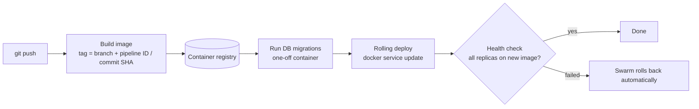

# cicd

CI/CD pipelines and deployment configs I wrote to ship containerised web, backend and Flutter apps. They run on GitLab CI and GitHub Actions and deploy to Docker Swarm with rolling updates.

## Pipeline shape

Pushes to `develop` deploy to staging automatically. `main` goes to production with a manual approval (`when: manual`) on the riskiest step, which is the database migration for backends and the deploy itself for the frontend. A health-check job runs after every deploy.

## What's inside

| Folder | Contents |
|---|---|
| [`gitlabci/`](gitlabci) | Backend pipeline (build, migration, deploy, for staging and production), a variant with separate app server and web server images, a frontend build/deploy, and a Flutter pipeline that builds staging and production APKs as artifacts with pub and Gradle caching |
| [`githubaction/`](githubaction) | The backend and frontend flows on GitHub Actions: build and push tagged by commit SHA, a migration job, and a deploy over SSH to a Swarm manager. Credentials come from repository secrets. |
| [`swarm/`](swarm) | Stack files with 3 replicas, `start-first` rolling updates (2 at a time, 5 s delay, 60 s monitor), `failure_action: rollback` and container health checks |
| [`bashscripts/`](bashscripts) | `healthcheck.sh` waits until every replica runs the new image and fails the pipeline on a rollback or timeout. `substitute_env_vars.sh` fills `.env` templates from CI variables. |
| [`docker-compose/`](docker-compose) | Laravel app server and web server with health checks |
| [`sonarqube/`](sonarqube) | SonarQube project config that waits for the quality gate (`sonar.qualitygate.wait=true`) |

## Design choices

Every image is tagged with the branch and pipeline ID on GitLab, or the commit SHA on GitHub. Any running container can be traced back to its commit and redeployed.

Migrations run in a one-off container from the new image before the new version takes traffic.

Swarm starts the new tasks and waits for their health checks before it stops the old ones, so deploys don't drop requests, and a failed update rolls back on its own.

The deploy job waits until Swarm reports every replica running the new image before it passes.

Registry logins use CI job tokens or repository secrets, and the runtime `.env` is generated at deploy time, so the repo holds no credentials.
